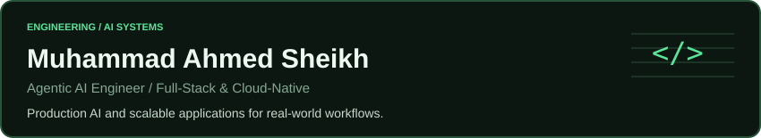
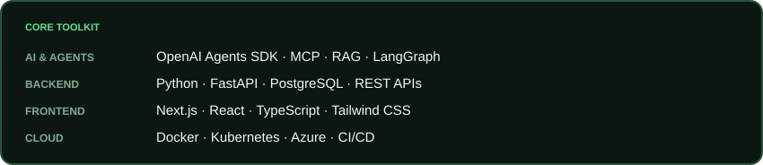
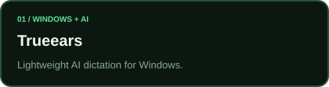
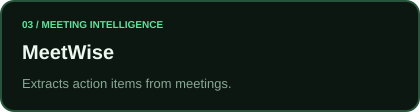

<a href="https://www.linkedin.com/in/ahmed9ww/">LinkedIn</a> &nbsp; / &nbsp; <a href="https://ahvem.com/">Portfolio</a> &nbsp; / &nbsp; <a href="https://ahvem.com/contact">Contact</a>

## About

I'm an engineer in Islamabad building production SaaS applications and AI systems at Society 5 Solutions LLC. With approximately two years of professional experience and five years of hands-on development, I focus on agentic AI, backend systems, and cloud-native architecture.

## Core toolkit

## Selected work

  
  
  
  

Select XeroAgent to view its public repository.

## Activity

GitHub activity reflects data available to these services and does not represent all work or necessarily include private contributions. Widgets may be cached or temporarily unavailable.

## Let's connect

Interested in building production AI systems or scalable applications? Let's connect.

[LinkedIn](https://www.linkedin.com/in/ahmed9ww/) &nbsp; / &nbsp; [Portfolio](https://ahvem.com/) &nbsp; / &nbsp; [Contact](https://ahvem.com/contact)
